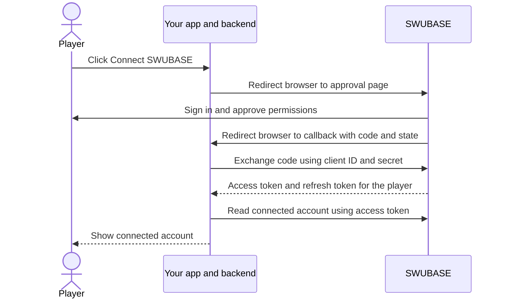

# Connect a player's account

[Developer guide](../third-party-integrations.md) · [Next: send game results](game-results.md)

Before starting, [register your app](../third-party-integrations.md#register-an-app)
and configure its client ID, client secret, SWUBASE origin, and exact callback
URL on your backend. The examples request both available permissions.



## 1. Start from a signed-in session in your app

The player initiates linking from your app. Your backend should:

1. Require the player's current session in your app and protect the action with
   your normal request-origin/CSRF checks.
2. Generate a fresh unpredictable `state` value, between 16 and 512 characters.
3. Save it with the initiating session and local player ID in server-side
   storage. Give this pending attempt a short lifetime, such as ten minutes.
4. Redirect the browser to SWUBASE using the parameters below.

`state` lets your callback verify that the response belongs to the player who
started the connection. It must not be a predictable user ID or a fixed string
shared by all players. Use a new value for every attempt.

### Approval URL

Browser destination: `{SWUBASE_ORIGIN}/settings/link/app`.

| Query parameter | Required value                                                         |
| --------------- | ---------------------------------------------------------------------- |
| `response_type` | `code`                                                                 |
| `client_id`     | Your app's client ID                                                   |
| `redirect_uri`  | An exact registered callback URL                                       |
| `scope`         | Space-separated permissions, such as `profile:read game-results:write` |
| `state`         | The random value you saved for this attempt                            |

Every requested permission must be registered for your app. Duplicate and unknown
permissions are rejected. Encode the query with a URL builder.

This backend JavaScript helper builds the URL and the pending state to store:

```js
import { randomBytes } from 'node:crypto';

export function prepareSwubaseLink({ swubaseOrigin, clientId, redirectUri, appUserId, sessionId }) {
  const state = randomBytes(32).toString('hex');
  const pending = {
    state,
    appUserId,
    sessionId,
    expiresAt: Date.now() + 10 * 60 * 1000,
  };
  const url = new URL('/settings/link/app', swubaseOrigin);
  url.search = new URLSearchParams({
    response_type: 'code',
    client_id: clientId,
    redirect_uri: redirectUri,
    scope: 'profile:read game-results:write',
    state,
  }).toString();
  return { pending, authorizationUrl: url.href };
}
```

Use your authenticated session to supply `appUserId` and `sessionId`. Persist
`pending` before redirecting; do not trust those identifiers from URL parameters.
The helper's ten-minute timeout is a suggested policy in your app. SWUBASE's
separate authorization-code lifetime begins after approval and is five minutes.

Open SWUBASE in a normal browser tab or window. The approval screen cannot be
embedded in an iframe. The player signs in if needed, reviews the app and
permissions, then selects **Allow access** or **Deny**.

## 2. Handle the callback

After approval, SWUBASE navigates to your registered callback with:

```text
https://your-app.example/integrations/swubase/callback?code=RETURNED_CODE&state=RETURNED_STATE
```

After denial:

```text
https://your-app.example/integrations/swubase/callback?error=access_denied&state=RETURNED_STATE
```

Your callback must perform these steps in order:

1. Require the same signed-in local player and session that started linking.
   Configure your session cookie so it is available on this top-level callback.
   If the session is gone or belongs to another player, ask them to start again.
2. Require exactly one `state` query parameter. Reject missing, duplicate,
   mismatched, or expired state. Look it up against that session and local player.
3. Atomically consume the matching pending attempt so a second callback cannot
   process it again. Do not consume a different attempt on a state mismatch.
4. If `error=access_denied`, show “Connection cancelled.” Do not exchange a code.
   Treat any other error as a failed attempt.
5. Otherwise require exactly one nonempty `code`, with no `error`, and exchange
   it once from your backend. Reject ambiguous duplicate response parameters.
6. Save the returned tokens for the initiating local player, identify the
   SWUBASE account, and redirect to a clean page in your app without the callback
   query parameters.

Do not trust a `userId` appended to the callback as the owner of the connection.
State validation also applies to denied requests. Avoid logging callback query
strings or loading analytics on the callback page.

## 3. Exchange the code

Send `POST {SWUBASE_ORIGIN}/api/integration-apps/token` from your backend with
`Content-Type: application/json`:

```json
{
  "grant_type": "authorization_code",
  "client_id": "YOUR_CLIENT_ID",
  "client_secret": "YOUR_CLIENT_SECRET",
  "code": "RETURNED_CODE",
  "redirect_uri": "https://your-app.example/integrations/swubase/callback"
}
```

Use the same `redirect_uri` you used to initiate linking, without the returned
`code` and `state`. The code is valid for five minutes and can be exchanged once.
It is tied to your app, that callback URL, the approving player, and the approved
permissions.

Approving another linking attempt for the same app and player replaces the
previous unused code. If the player has several linking tabs open, complete the
latest approval rather than exchanging a code from an older tab.

Backend JavaScript using the Fetch API:

```js
export async function exchangeSwubaseCode({
  swubaseOrigin,
  clientId,
  clientSecret,
  redirectUri,
  code,
}) {
  const requestedAt = Date.now();
  const response = await fetch(new URL('/api/integration-apps/token', swubaseOrigin), {
    method: 'POST',
    headers: { 'Content-Type': 'application/json' },
    body: JSON.stringify({
      grant_type: 'authorization_code',
      client_id: clientId,
      client_secret: clientSecret,
      code,
      redirect_uri: redirectUri,
    }),
    signal: AbortSignal.timeout(15_000),
  });
  if (!response.ok) {
    throw new Error(`SWUBASE code exchange failed (${response.status})`);
  }
  const tokens = await response.json();
  return {
    accessToken: tokens.access_token,
    refreshToken: tokens.refresh_token,
    accessExpiresAt: requestedAt + tokens.expires_in * 1000,
    refreshExpiresAt: requestedAt + 30 * 24 * 60 * 60 * 1000,
    scopes: tokens.scope.split(' '),
  };
}
```

These helpers are framework independent. Wire them into your own routes,
session validation, pending-attempt storage, and connection storage. Call the
exchange helper only after the callback checks above.

A successful exchange returns HTTP `200` with these top-level fields:

```json
{
  "access_token": "swu_access_REPLACE_WITH_RETURNED_VALUE",
  "refresh_token": "swu_refresh_REPLACE_WITH_RETURNED_VALUE",
  "token_type": "Bearer",
  "expires_in": 3600,
  "scope": "profile:read game-results:write"
}
```

The strings shown are placeholders. Store the exact tokens returned by SWUBASE;
they are opaque credentials, not JWTs. The response has **no `data` wrapper**
and no ID token. Keep tokens on your backend.

Do not automatically retry a code exchange after a timeout or a lost response:
the code may already have been consumed. Restart linking if you cannot recover
the saved tokens from your own storage.

## 4. Identify the connected account

With `profile:read`, send:

```http
GET /api/integration-apps/me
Authorization: Bearer YOUR_ACCESS_TOKEN
```

HTTP `200`:

```json
{
  "data": {
    "id": "SWUBASE_USER_ID",
    "displayName": "Player"
  }
}
```

Store the SWUBASE ID with your local player ID and tokens. Use `displayName`
for presentation, not as a stable identifier. This endpoint does not return an
email address. If profile loading temporarily fails after you have saved the
tokens, retry the profile request instead of exchanging the code again.

Show a confirmation such as “Connected to SWUBASE as Player.” If this is the
wrong account, the player can disconnect and link again with the correct
SWUBASE session. An existing connection to a different SWUBASE ID should be an
explicit account change in your app.

There is one active connection per app and SWUBASE player. Completing linking
again replaces the previous tokens. If your app serves the player on several
devices, use its shared backend connection instead of creating independent
SWUBASE connections for each device.

Continue with [Send game results](game-results.md) and
[Manage tokens and connections](token-lifecycle.md).
